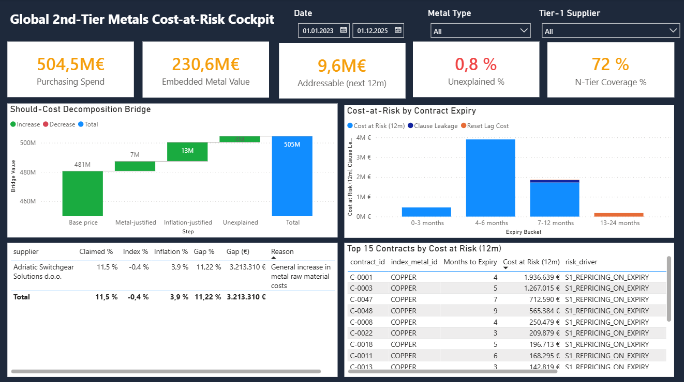
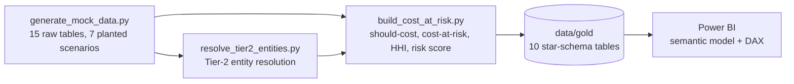

# Global 2nd-Tier Metals Cost-at-Risk Cockpit

End-to-end commodity-management analytics for a mock electrical-equipment manufacturer that buys copper, aluminium, steel, silver and zinc **indirectly** through its Tier-1 suppliers.
A Python pipeline turns raw procurement data into a Power BI cockpit that answers three questions a commodity manager gets asked every quarter:

1. **What should we have paid?** Index-based should-cost vs. what suppliers actually invoiced.
2. **What will repricing cost us next?** Euro exposure on contracts that expire after a metal price ramp.
3. **Who really supplies us at Tier-2?** Hidden single-source dependencies behind differently spelled sub-supplier names.

> All data is **synthetic** (seeded, fully reproducible). Company and supplier names are fictional.



## Key findings

| Finding | Value | Why it matters |
|---|---|---|
| Spend modelled (2023–2025) | **€504.5M**, of which **€230.6M (46%)** is embedded metal | Metal is the largest single cost driver in the BOM |
| Unjustified surcharge (supplier T1-004) | **€3.2M / year** | Supplier claims +11.5%; index and inflation justify only ~3.5% |
| Cost at risk on expiring fixed-price copper contracts | **€6.1M** in the next 12 months | Renegotiate or hedge before expiry, not after |
| Clause leakage + reset-lag cost | **€0.3M / year** | Caps, floors and 3-month lags that work against the buyer |
| **Total addressable** | **€9.6M** | Prioritised, euro-quantified action list |
| Tier-1 metal spend with no declared Tier-2 | **€64.3M (28%)** | N-tier transparency gap |
| Aluminium concentration (HHI) | **2,888 → 6,642** after entity resolution | One smelter hides behind 3 spellings across 6 Tier-1s and holds 81% of the aluminium spend |
| Metal value at Tier-2s below the cyber-maturity line | **€133M** | Supply risk beyond price |
| CBAM-liable imported metal | **13,119 t**, ~206k tCO₂e embedded | Carbon cost exposure from 2026 |

## How it works



| Step | Method |
|---|---|
| **Mock data** | Market regimes (copper ramp, aluminium energy crisis, USD strengthening) with stochastic noise. Prices are *caused* by contract clauses: `unit price = base × (1 + clip(pass-through × metal share × index move, floor, cap)) × escalation`. About 25 assertions check that every planted scenario is present. |
| **Entity resolution** | Name normalisation (legal forms, transliteration, synonyms), blocking by country × metal, weighted score (Jaro-Winkler 0.40, token-set 0.35, bigram Dice 0.25), union-find clustering, golden-record survivorship. Threshold chosen by an F1 sweep; borderline pairs (0.78–0.90) go to a review queue. |
| **Should-cost bridge** | Invoice value split into *base price + metal-justified + inflation-justified + unexplained*. The unexplained residual is the negotiation lever. |
| **Cost at risk** | Repricing gap at contract expiry, plus clause leakage (floors that block price drops) and reset-lag cost, pro-rated to the next 12 months. |
| **N-tier & concentration** | Declared Tier-2 shares × Tier-1 metal spend; HHI before vs. after entity resolution; composite risk score (concentration 30%, cyber 25%, geopolitical 25%, compliance 20%). |
| **Power BI** | Star schema, measures grouped by topic, waterfall bridge, expiry-bucket analysis, parameterised data source. |

**Entity resolution result:** 48 raw Tier-2 records → 20 real entities, 100% precision and recall against the synthetic ground truth. Real-world data would score lower; that's what the review queue is for.

## Run it yourself

Requires Python 3.11+ (tested on 3.13) and Power BI Desktop (Windows).

```powershell
python -m venv .venv
.venv\Scripts\activate
pip install -r requirements.txt

python Mock_Project/scripts/generate_mock_data.py
python Mock_Project/scripts/resolve_tier2_entities.py
python Mock_Project/scripts/build_cost_at_risk.py
```

The CSV outputs are already committed, so you can skip straight to Power BI:

1. Open `Mock_Project/powerbi/Commodity_Management.pbip` in Power BI Desktop.
2. **Transform data → Edit parameters** → set `DataFolder` to your clone's `Mock_Project\data\` folder (keep the trailing backslash).
3. **Refresh**.

## Repository structure

```
Mock_Project/
├── scripts/      Python pipeline (run in the order above)
├── data/
│   ├── raw/        generated source tables + entity-resolution answer key
│   ├── processed/  entity-resolution outputs and evaluation
│   └── gold/       star-schema tables loaded by Power BI
├── notebooks/
│   ├── 00_project_walkthrough.ipynb   step-by-step explanation of every phase
│   └── 01_powerbi_dax_measures.ipynb  DAX measures and page layout
└── powerbi/
    ├── Commodity_Management.pbip      Power BI project (text-based, diff-friendly)
    ├── Commodity_Management.pbix      same report as a single file
    └── measures.dax                   all measures in one script
```

## Limitations

- Synthetic data: the scenarios are planted, so the analysis finds what was designed to be found. The value is in the method, not the numbers.
- Market indices and FX are simulated monthly series, not licensed LME/Platts data.
- CBAM emission factors are simplified default values.
