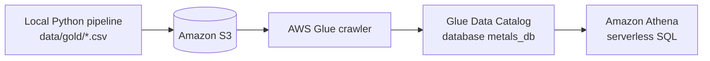
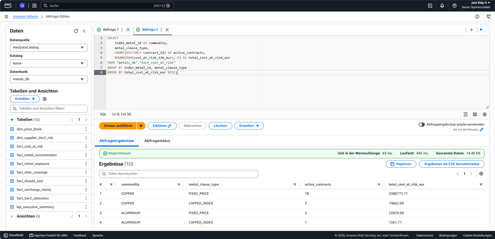

# AWS Data Lake: S3, Glue and Athena

The 10 gold tables of the cost-at-risk model are also published to AWS, cataloged automatically and queried with SQL. This is an optional extension. The Power BI report still reads the local CSVs.

The query ([athena_cost_at_risk_by_commodity.sql](../Mock_Project/sql/athena_cost_at_risk_by_commodity.sql)) returns the same figures as the local pipeline: copper fixed-price contracts carry **€5.99M** of the **€6.09M** total cost at risk (18 contracts).

## What was set up

| Step | Service | Result |
|---|---|---|
| 1 | S3 (Region `eu-north-1`) | Private bucket, public access blocked, one folder per gold CSV |
| 2 | Glue crawler | Reads the S3 folders, infers column names and types, writes tables to the Data Catalog |
| 3 | Glue Data Catalog | Database `metals_db` with the 10 gold tables |
| 4 | Athena | SQL on the S3 files via the catalog, no server to manage |

Tables in `metals_db`: `dim_price_book`, `dim_supplier_tier2_risk`, `fact_cost_at_risk`, `fact_metal_concentration`, `fact_metal_exposure`, `fact_ntier_coverage`, `fact_should_cost`, `fact_surcharge_claims`, `fact_tier2_allocation`, `kpi_executive_summary`.

## Reproduce it

1. Create a private S3 bucket and upload each file from `Mock_Project/data/gold/` into its own folder, e.g. `s3://<your-bucket>/gold/fact_cost_at_risk/fact_cost_at_risk.csv`. One folder per table lets the crawler create one table per folder.
2. In AWS Glue, create a database `metals_db` and a crawler with the S3 path `s3://<your-bucket>/gold/` as its target, pointing at that database. Run it.
3. Open Athena, choose the `metals_db` database, set a query result location (an S3 prefix outside `gold/`), and run the SQL file above.

Check the inferred column types after the crawl. Crawlers guess from the CSV contents, so numeric columns can come out as the wrong type.

## Notes

- Synthetic data only. Do not upload real company or supplier data.
- Use one Region for S3, Glue and Athena.
- Never commit credentials or account IDs.
- Cost: S3 storage, crawler runs and Athena data scanned are billed. The query above scans about 14 KB. Delete the objects, crawler and database when finished.
- Not done: connecting Power BI to Athena (it would need the Athena ODBC driver and changed Power Query sources).
